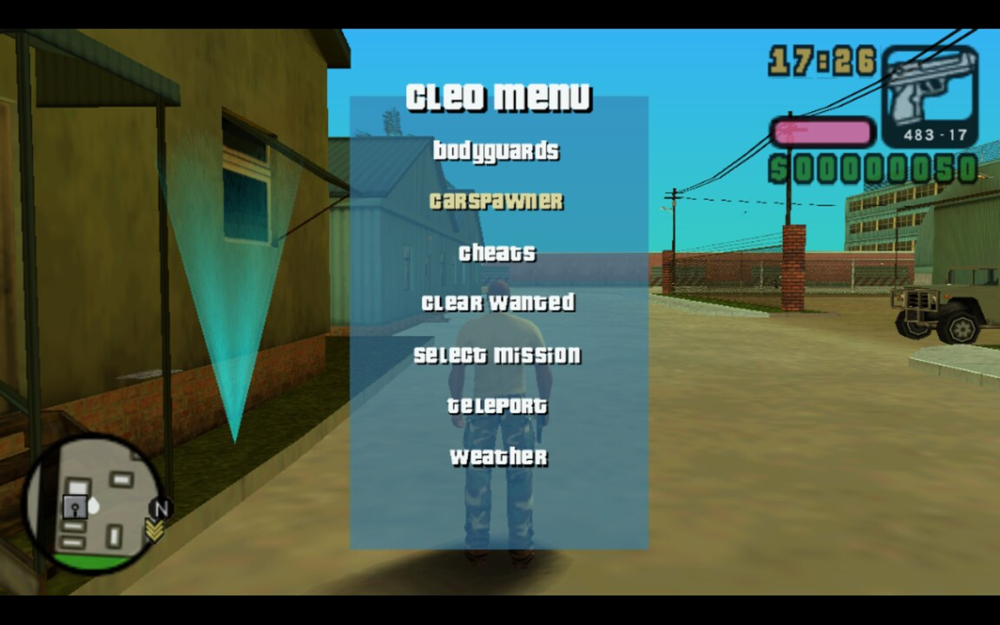
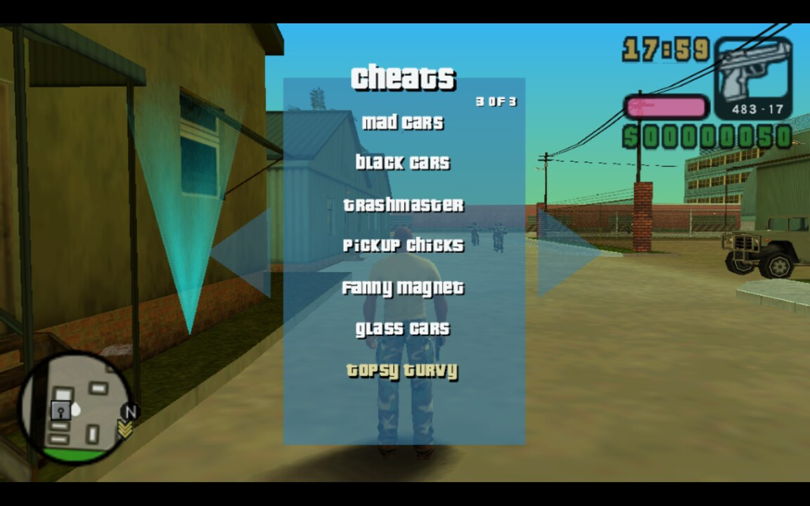
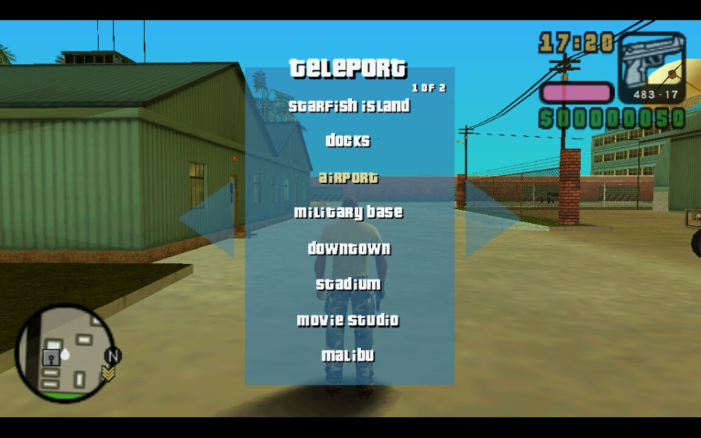
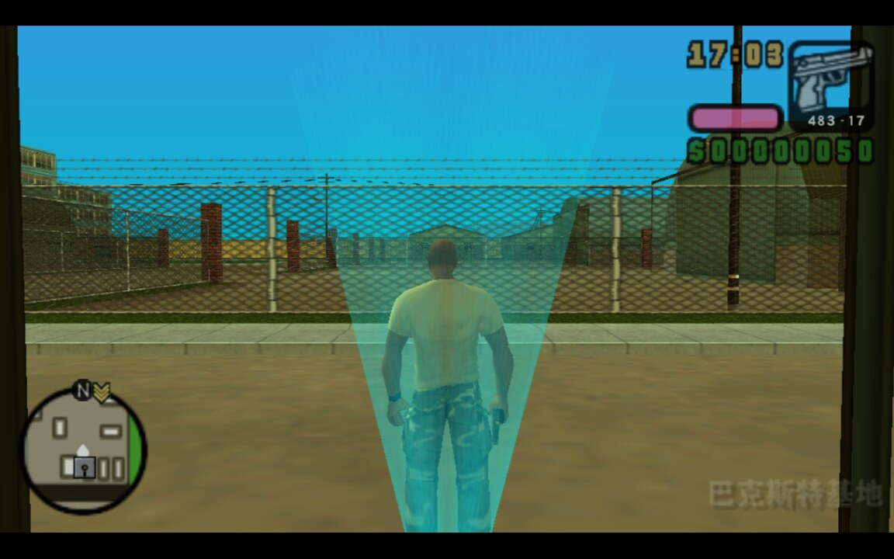

# GTA VCS 汉化版 × CLEO PSP 兼容修复

[English summary ↓](#english)

让 **Grand Theft Auto: Vice City Stories** 的日版基底汉化版（`ULJM05297` v1.01）在
PPSSPP 上正常使用 CLEO PSP 脚本引擎。

上游 [CLEO PSP](https://github.com/cleolibrary/GTALCS.GTAVCS.PSP.CLEO) 官方只支持
`ULES00502` / `ULES00503` / `ULUS10160`（美/欧版），不含日版；而这个汉化版正是以日版为基底
（外置字体、不同编译结果），直接套用会崩溃、菜单也全是乱码。



## 修复了什么

| # | 现象 | 根因 |
|---|---|---|
| 1 | 开场动画结束、开始加载游戏数据时 PPSSPP 崩溃 | 2.0.2 用未对齐的 32 位读取脚本指令流；2026-08 之后的 PPSSPP 会对这种访问返回 0，脚本 ip 被写坏，CPU 跑进数据区 |
| 2 | 进入游戏几秒后 `CPU Jump to 00000000` | `autoaim` 脚本按美/欧版特征搜索 `CPad::GetPad`，本镜像中不存在，返回 0 后被当作函数调用 |
| 3 | CLEO 菜单文字乱码（`cleo menu` → `engq ogPw`，列表只剩首字母） | 汉化版替换了游戏外置字体 `FSFONTSJP1.XTX`，字模表重排且只有一套字母字形块 |

详细的技术分析（含日志、反汇编定位、字符码对照实验）见
**[docs/ROOT-CAUSE.md](docs/ROOT-CAUSE.md)**。

## 快速开始

### 普通用户

1. 到 [Releases](../../releases) 下载 `cleopsp-vcs-chs-fix.zip`
2. 解压，把 `memstick/` 里的内容覆盖到 PPSSPP 的 memstick 目录：

   | 平台 | 路径 |
   |---|---|
   | Windows | `ppsspp 安装目录\memstick\PSP\PLUGINS\cleo\` |
   | Linux | `~/.config/ppsspp/PSP/PLUGINS/cleo/` |
   | macOS | `~/Library/Application Support/PPSSPP/PSP/PLUGINS/cleo/` |
   | Android | `Android/data/org.ppsspp.ppsspp/files/PSP/PLUGINS/cleo/` |

3. 启动游戏，按两次 **Start** 打开 CLEO 菜单

> `plugin.ini` 里必须有 `ULJM05297 = true`，否则日版根本不会加载插件。发布包里已经加好了。

### 从源码构建

```bash
# 1. 获取 pspdev 工具链（约 173 MB，解压即用）
curl -LO https://github.com/pspdev/pspdev/releases/download/v20261001/pspdev-ubuntu-latest-x86_64.tar.gz
tar xzf pspdev-ubuntu-latest-x86_64.tar.gz

# 2. 自动拉取上游 + 打补丁 + 编译
PSPDEV=$PWD/pspdev ./build/build-cleo.sh

# 3. 安装
./scripts/install.sh
```

产物应为 **523,514 字节**，MD5 `b229cffcb0f837d0b3dbac2ccd701242`（构建可复现）。

## 截图

| 主菜单 | cheats 子菜单 | teleport 子菜单 |
|---|---|---|
|  |  |  |

汉化正文与 HUD 不受影响：



## 配置项

安装后 `PLUGINS/cleo/cleo.ini`：

```ini
text_offset=-2
text_offset_disc=ULJM05297
```

| 键 | 说明 |
|---|---|
| `text_offset` | 字符码偏移量。字母 `-2`，数字自动 `-1`，空格不变 |
| `text_offset_disc` | 可选，仅在指定光盘 ID 上应用；不写则对所有镜像生效 |

菜单文字显示不对时可直接改数字后重启游戏（不必重新编译）：

- 显示成 `ajcn kcls` 之类 → 偏移过头，改 `-1` 或 `0`
- 显示成 `gptu rgtx` 之类 → 偏移不足，改 `-3`

玩未汉化的美版/欧版时，把 `text_offset` 设为 `0` 即可（或者依赖 `text_offset_disc` 自动跳过）。

## 已知限制

- **autoaim 不可用**：该脚本按美/欧版代码特征定位 `CPad::GetPad`，日版编译结果不同。
  现在会记录 `stopping script 'gtavcs.autoaim.csa'` 并安全跳过，**不会影响游戏稳定性**。
  想要恢复需针对该版本重新定位函数并改写脚本里的特征串（偏移 209 处的 ASCII，长度 ≤ 47 字符）。
- 其余脚本（无敌、无限弹药、传送、刷车、天气、保镖、清除通缉等）工作正常。

## 仓库结构

```
patches/cleo-vcs-chs.patch   相对上游 main 分支的完整改动（patch -p1）
build/build-cleo.sh          拉取上游 + 打补丁 + 编译
scripts/install.sh           安装到 PPSSPP（自动备份、补 plugin.ini）
scripts/uninstall.sh         回滚到原版 2.0.2
config/cleo.ini              text_offset 配置样例
docs/ROOT-CAUSE.md           三个问题的技术分析
docs/screenshots/            实机验证截图
```

## 许可与声明

- 本项目是**社区非官方补丁**，与 CLEO、Rockstar Games 均无隶属关系，未获其背书。
- 上游 CLEO PSP 采用 BSD 3-Clause（Copyright © 2024 Alexander Blade），本仓库的修改
  同样以 BSD 3-Clause 发布，详见 [LICENSE](LICENSE) 与 [NOTICE.md](NOTICE.md)。
- 不含任何游戏本体或游戏数据；请自行准备合法拥有的游戏镜像。

---

## English

Unofficial compatibility fix for running [CLEO PSP](https://github.com/cleolibrary/GTALCS.GTAVCS.PSP.CLEO)
on the **Japanese-based Chinese translation** of GTA: Vice City Stories (`ULJM05297` v1.01) under PPSSPP.

Upstream only supports `ULES00502` / `ULES00503` / `ULUS10160`. This port fixes three distinct failures:

1. **Crash right after the intro cutscene** — CLEO 2.0.2 read the script command stream with
   unaligned 32-bit loads; PPSSPP builds from Aug 2026 onwards return 0 for those, corrupting the
   script ip and sending the CPU into data. Fixed by building from upstream `main` (2.0.3).
2. **`CPU Jump to 00000000` a few seconds into gameplay** — the `autoaim` script locates
   `CPad::GetPad` by a US/EU byte pattern that does not exist in this build, so the address is 0
   and `0DDE call_func` jumps to it. Now guarded: the script is stopped and logged instead of
   taking the emulator down.
3. **Garbled CLEO menu text** (`cleo menu` → `engq ogPw`) — the translation replaces the external
   font, reordering the glyph table. A configurable `text_offset` (letters −2, digits −1,
   uppercased first) maps characters back. Only applied when `text_offset_disc` matches.

Download the zip from [Releases](../../releases) and copy `memstick/` over your PPSSPP data
directory. Build instructions above; expected artifact is 523,514 bytes, MD5
`b229cffcb0f837d0b3dbac2ccd701242`.
